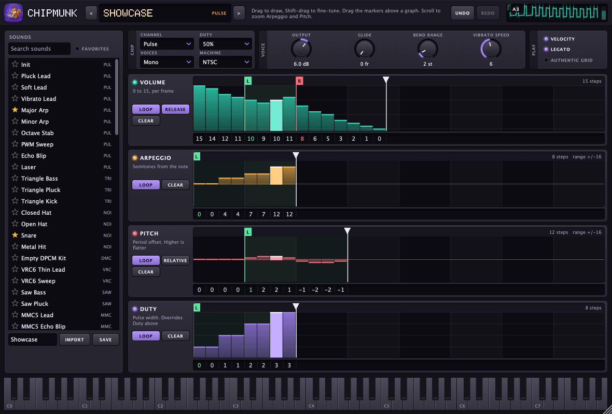

<p align="center">
  
</p>

# Chipmunk

Chipmunk is a chiptune instrument for your DAW. It's built on
[FamiStudio](https://famistudio.org)'s audio engine and plays eight sound chips: 2A03, VRC6, VRC7,
MMC5, FDS, N163, S5B and EPSM.

Your DAW handles composing, arranging and mixing. Chipmunk handles sound design and chip playback.



> **Early days:** Chipmunk is mostly used and tested on Apple Silicon Macs. Builds for macOS, Windows
> and Linux come from [GitHub Actions](https://github.com/varomix/chipmunk/actions), and tagged versions
> are on the [Releases](https://github.com/varomix/chipmunk/releases) page. They aren't signed, so
> your system may warn about them. The README inside each download explains what to do.

## Listen

Three of the songs in [examples](examples), recorded straight from Chipmunk without any of Live's
effects. Each one is a Live Set you can open and take apart.

**First Stage** · 2A03

<!-- Video: Chipmunk - First Stage.mp4 -->

**Crystal Cavern** · 2A03, VRC6, MMC5 and S5B

<!-- Video: Chipmunk - Crystal Cavern.mp4 -->

**Neon Causeway** · all eight chips

<!-- Video: Chipmunk - Neon Causeway.mp4 -->

## Features

- **Eight chips, one device:** choose a channel on each track, from Pulse and Triangle to VRC6 Saw,
  VRC7 FM and EPSM Rhythm. Saved Sets keep their sounds without any external files.
- **Drawable envelopes:** draw volume, arpeggio, pitch and duty, or type them as text like
  `15 12 9 | 6 4 / 2`. Hold Shift while dragging to fine-tune a value.
- **Optional polyphony:** play up to 8 voices on one track, with each note on its own chip.
- **Drum Kit channel:** map samples and noise sounds to keys.
- **Sound browser:** 61 factory sounds, search and favorites, plus import of `.fms` and `.fti` files.
- **Play from your computer keyboard:** in the standalone app, the letter keys play notes and Z and X
  change the octave. Notes from any source light up the on-screen keyboard.
- **MIDI control:** draw FamiStudio's note effects, like slides, fine pitch and vibrato, as clip
  envelopes.

The engine matches FamiStudio's 100% at the chip register level, and its audio comes out identical or
within a rounding error.

## Build

You need CMake 3.22 or later, a C++20 compiler and an internet connection for the first build, which
downloads JUCE. On macOS 11 or later that means the Xcode Command Line Tools, and on Windows, Visual
Studio. On Linux, install the packages listed in [the CI workflow](.github/workflows/build.yml).

```bash
git clone git@github.com:varomix/chipmunk.git
```

```bash
cd chipmunk
```

```bash
cmake -B build -DCMAKE_BUILD_TYPE=Release
```

```bash
cmake --build build
```

On macOS and Linux, the build installs the plugins, to `~/Library/Audio/Plug-Ins` or `~/.vst3`. On
Windows they stay in `build/Chipmunk_artefacts`, as the system's plugin folder needs admin rights.
The standalone app is in `build/Chipmunk_artefacts/Release/Standalone`. Restart your DAW to load a
new build.

On Windows, the golden tests also need [zlib](https://github.com/microsoft/vcpkg), and are skipped
without it.

To run the tests:

```bash
ctest --test-dir build
```

## Getting started

- **Templates:** [`templates/`](templates) has Ableton Live Sets with tracks already set up, one for
  the 2A03 and one for all the chips.
- **Examples:** [`examples/`](examples) has songs you can open in Live and take apart.
- **Presets:** your own sounds are saved as `.chmk` files in `Chipmunk/Presets` in your Music folder.

## Credits and license

Copyright (C) 2026 varomix. Chipmunk is free software, licensed under the [GNU AGPLv3](LICENSE), and
comes with no warranty. The **?** button in the app shows this notice. If you pass on a build, the
AGPL means you must also offer its complete source. Each [release](https://github.com/varomix/chipmunk/releases)
has a source bundle that includes JUCE.

It's built on FamiStudio by BleuBleu and JUCE,
among others. See [THIRD_PARTY_NOTICES.md](THIRD_PARTY_NOTICES.md) for the full list. Example songs by
other composers belong to them, as listed in the [examples README](examples/README.md).

Chipmunk isn't affiliated with or endorsed by FamiStudio.
